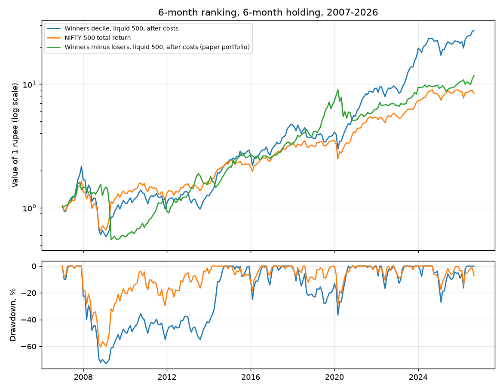

# Returns to Buying Winners and Selling Losers in India

A replication of Jegadeesh and Titman (1993) for Indian shares on NSE: all 32 J/K momentum strategies of their Table I, the paper's other tables where Indian data allows, and long-only versions an Indian investor could hold, measured after Indian trading costs against the NIFTY 500 total return. Two universes are used: every NSE share that traded (universe A, as the paper does) and the 500 most traded (universe B, which an investor could actually hold). The main sample is holding months January 2007 to September 2026.

**In one line:** buying past winners beat selling past losers in all 64 strategy runs, 1.5% a month for the paper's 6-month/6-month strategy (the paper: 0.95%), and a long-only portfolio of the winners returned 18.2% a year after costs against 11.4% for the NIFTY 500 total return; but the long-short portfolio cannot be held in India, the long-only lead came almost entirely after 2013, and the long-only portfolio fell 73% in 2008.



## Interactive companion

A static, paper-styled page (Apache ECharts, no server) lets you choose any of the 64 portfolios and see its growth, drawdowns and monthly calendar against the NIFTY 500 total return, all 32 strategies beside the paper's Table I, the paper's other tables, and the cost, robustness and delisting checks. Every view has a link, for example `#a-j12-k3-skip`. It lives in `src/jegadeesh_titman_india/site/` and is published to GitHub Pages only after approval. To run it on your own computer:

```
pip install -e ".[plots]"
jt-momentum-app
```

`.venv/bin/python -I -m jegadeesh_titman_india.scripts.build_snapshot .` rebuilds the page's data from the results; it contains derived results only, never raw exchange data.

## Headline results

6-month ranking, 6-month holding, no skipped week: the strategy fixed in advance as the headline. 237 holding months. Net of costs means brahmagupta's 2026 NSE delivery costs plus market impact of 0.3% a side in A and 0.1% in B.

| Universe | Portfolio | Gross mean/month | Net mean/month | Newey-West t (net) | CAGR after costs | Worst drawdown |
|---|---|---|---|---|---|---|
| A (every share) | winners minus losers, paper portfolio | 1.49% | 1.19% | 2.7 | 12.2% | -62% |
| A | winners only | 2.17% | 2.04% | 3.3 | 21.8% | -72% |
| B (liquid 500) | winners minus losers, paper portfolio | 1.48% | 1.33% | 2.8 | 13.3% | -65% |
| B | winners only | 1.79% | 1.73% | 3.0 | 18.2% | -73% |

The NIFTY 500 total return compounded at 11.4% a year over the same months. The full tables, each set beside the paper's, are in [`results/summary.md`](results/summary.md).

## What the Indian data says

1. **Momentum is strong.** All 64 long-short strategies (32 per universe) are positive before and after costs. The paper's 6/6 strategy earns 1.49% a month (A) and 1.48% (B); the paper found 0.95%. Leaving a week between ranking and holding raises returns when the week is the first after a month-end ranking, as in the paper, but not when the ranking window is ended a week early instead ([`results/comparison.md`](results/comparison.md)).
2. **Costs take 20% (A) and 10% (B) of the long-short return,** which stays positive after costs (Newey-West t 2.7 and 2.8).
3. **The profit is not market risk:** the winners-minus-losers beta is negative (-0.38 and -0.49), as in the paper.
4. **The winners carry the signal,** as in the paper: the loser leg is not significantly different from zero.
5. **No January effect, but a strong March** (the Indian financial-year end), with April and December negative.
6. **It was weak in 2007-2011** (t about 0.9, including the 2009 crash) and strong afterwards.
7. **No long-run reversal in 2007-2026,** where the paper finds half the profit lost within three years; the 1997-2006 sample for universe A does reverse.
8. **Announcement-period returns follow the paper:** winners beat losers around results early, then lose to them in months 8 to 20.
9. **The long-only portfolio's lead came late:** it was behind the index at each year end from 2008 to 2013. Its alpha over the risk-free rate is about 5% a year but not strongly significant (t 1.8).

## The paper in brief

Jegadeesh and Titman (1993) rank NYSE and AMEX shares on their returns over the past J months (3, 6, 9 or 12), buy the top decile and sell the bottom decile, and hold for K months (3, 6, 9 or 12), with and without a one-week gap, using overlapping portfolios. Over 1965-1989 every one of the 32 strategies earns a positive return, about 1% a month. They show the profit is not explained by market risk or by lead-lag effects between shares, that it is spread across size and beta groups, that it is negative in January, and that about half of it is gone within three years. Winners also beat losers around earnings announcements in the first months and lose to them later. The paper's tables are summarised in [`paper/summary.md`](paper/summary.md).

## What was changed for India, and why

| Item | Paper | India | Why |
|---|---|---|---|
| Universe | NYSE and AMEX, all shares | Universe A: every NSE EQ/BE/BZ share, funds removed. Universe B: the 500 most traded | A is the faithful copy; B is what an investor can trade |
| Dates | 1965-1989 | Holding months 2007-2026; 1997-2006 as an early sample | NSE's corporate action list is reliable from 2005 |
| Returns | CRSP | Daily total returns from NSE bhavcopies, adjusted for splits, bonuses and dividends | Bhavcopy prices are unadjusted |
| Short selling | Free | The long-short portfolio is a paper portfolio; long-only winners is the investable result | Overnight shorting of cash shares is not open to most investors |
| Costs | 0.5% one way | brahmagupta's Indian delivery costs on every strategy, plus market impact | House rule |
| Market and risk-free | CRSP index, 1-month bill | NIFTY 500 total return; 91-day T-bill (IIMA data, to December 2025) | Closest Indian match |
| Size | Market cap | Median daily traded value | No free market-cap history before February 2024 |
| Seasonality | January | All months; March is the Indian year end | India's tax year |
| Earnings dates | COMPUSTAT | NSE results filings, August 2007 to March 2025 | Only free source with timestamps |

The approved plan is in [`plan/india_plan.md`](plan/india_plan.md).

## Data

NSE daily bhavcopies from 1995 (including delisted shares), NSE corporate actions, the NIFTY 500 total return index, the IIMA four-factor library (risk-free rate and momentum factor for cross-checking), NSE market-cap files (2024 onward) and NSE results filings. UBI through tradingmachine supplied prices from December 2019 as a cross-check only: 98.7% of 2.9 million overlapping daily returns agree within 0.5%. Raw data is git-ignored and never published; see [`data/README.md`](data/README.md) for sources and counts. NSE's corporate action list and bhavcopies are not adjusted or complete in all years, as set out below.

## Detailed results

[`results/comparison.md`](results/comparison.md) sets this study beside an earlier study of the same paper made with Claude Code: the 32 long-short spreads agree to within 0.1 to 0.2 points a month (cell correlations 0.98 to 0.998), and the one visible difference, the effect of the skipped week, comes from where the gap falls in the calendar month.

[`results/summary.md`](results/summary.md) holds Table I with the paper's numbers beside India's, Tables II to IX, the headline strategies with cost sensitivity, robustness checks and the delisting stress. The CSV files in `results/` hold every number, including the net-of-cost columns and drawdowns for all 64 strategies (`table_one.csv`).

## Caveats

- **Many variants were tried:** 64 strategy runs (32 J/K strategies, two universes), each scored long-short and long-only. The headline was fixed before any result. 20 of 64 pass a Bonferroni cutoff on Newey-West t-statistics (|t| > 3.36); the strategies are highly correlated, so this is conservative.
- **Shorting is not possible for most Indian investors,** and no borrowing cost is charged.
- **Costs are 2026 rates** applied to the whole sample; market impact is an assumption. At double the impact, the 6/6 spread in universe A falls to 0.98% net.
- **Delisted shares are in the data, but nothing is charged after a share's last trade.** If every exiting winner lost 100%, the 6/6 spread would be 1.13% (A) and 1.20% (B) before costs.
- **Corporate actions are incomplete,** the early sample is the least reliable, renamed shares look like exits and new listings, and one-day moves beyond -50% or +100% were set to zero.
- **Universe A includes penny stocks** in the late 1990s.
- **Size is a proxy,** the risk-free rate stops in December 2025, and announcement data stops in March 2025.
- **The strongest evidence is after 2011,** and the sample is shorter than the paper's.
- **An independent reviewer reproduced the headline numbers** and found no look-ahead; its main points are reflected above.

## Reproducing the results

```
python3.14 -m venv .venv
.venv/bin/pip install -e ".[test,plots]"
.venv/bin/pip install -e /path/to/brahmagupta
.venv/bin/python -m jegadeesh_titman_india.data.downloads data 2026-10-16 full
.venv/bin/python -I -m jegadeesh_titman_india.scripts.build_daily_returns data
.venv/bin/python -I -m jegadeesh_titman_india.scripts.build_inputs data 2026-09
.venv/bin/python -I -m jegadeesh_titman_india.scripts.run_table_one data results
.venv/bin/python -I -m jegadeesh_titman_india.scripts.run_all_tables data results
.venv/bin/python -I -m jegadeesh_titman_india.scripts.draw_chart data results/figures/wealth.png
.venv/bin/python -I -m jegadeesh_titman_india.scripts.write_summary results paper
.venv/bin/python -I -m jegadeesh_titman_india.scripts.build_snapshot .
.venv/bin/pytest
```

The downloads take about an hour; the rest runs in about fifteen minutes. The paper's Table I is transcribed in `paper/paper_table_i.csv`; the paper's PDF is not included.

## Repository layout

```
src/jegadeesh_titman_india/data/       downloading and parsing NSE data, daily returns
src/jegadeesh_titman_india/momentum/   universes, ranking, cohorts, the tables
src/jegadeesh_titman_india/reporting/  summary, chart and the page's data snapshot
src/jegadeesh_titman_india/site/       the companion page (HTML, CSS, JavaScript, data)
src/jegadeesh_titman_india/scripts/    one program per step
tests/                                 offline tests on small made-up data
results/                               tables as CSV, summary.md, figures
paper/  plan/  data/                   source notes, approved plan, git-ignored data
.claude/notes/                         the reasoning behind each source file
```

## Citation

See `CITATION.cff`. Please also cite the original paper: Jegadeesh, N. and Titman, S. (1993), Returns to Buying Winners and Selling Losers: Implications for Stock Market Efficiency, The Journal of Finance 48(1), 65-91, doi:10.1111/j.1540-6261.1993.tb04702.x.
